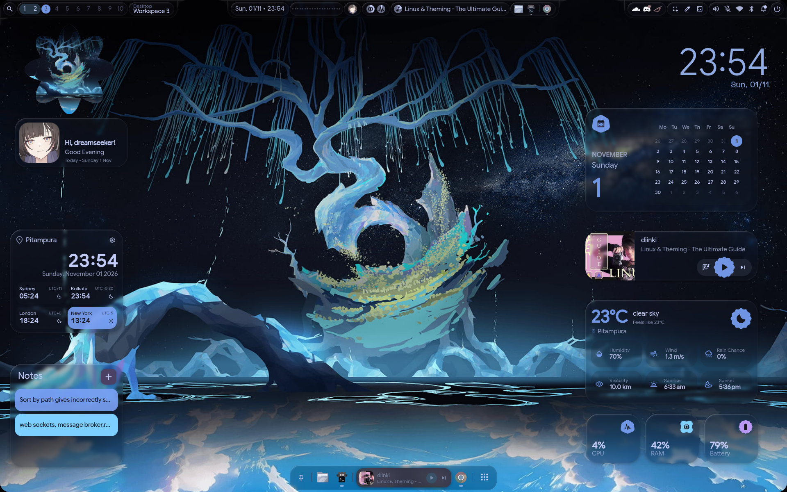
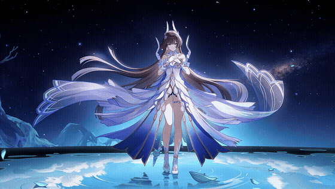
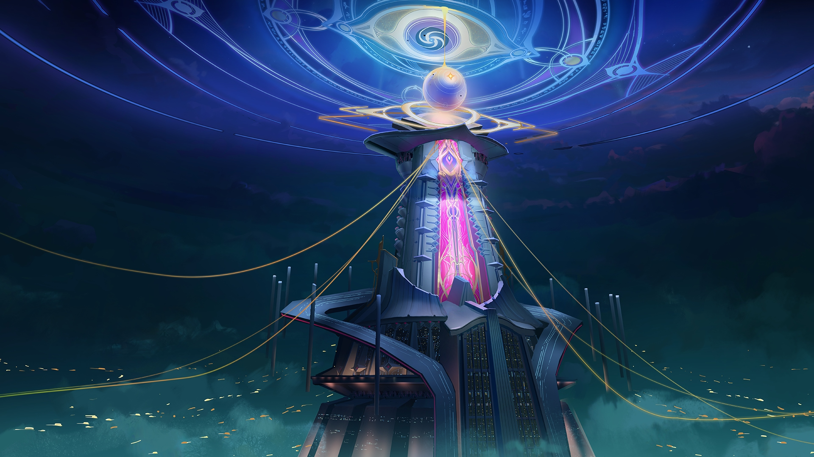
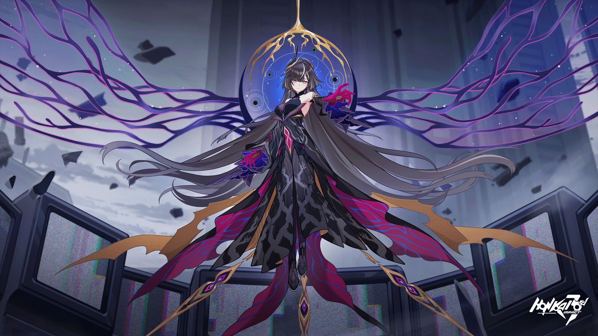
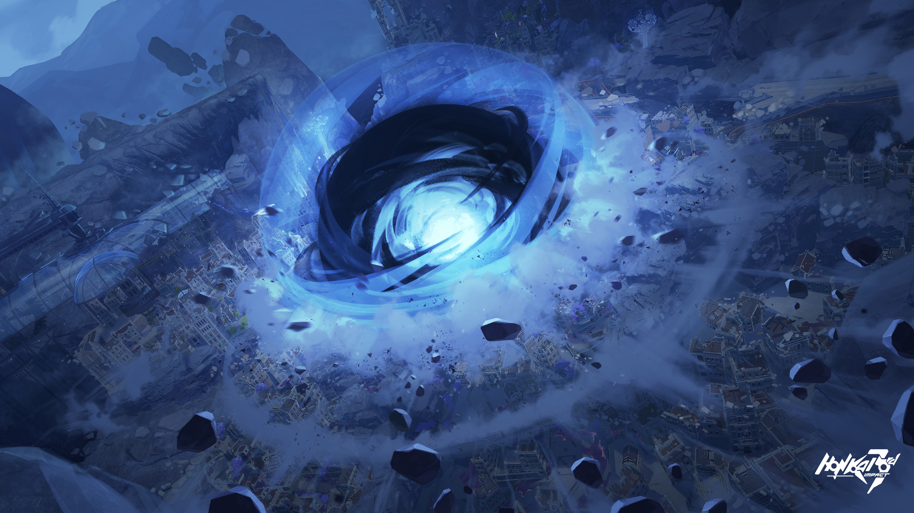
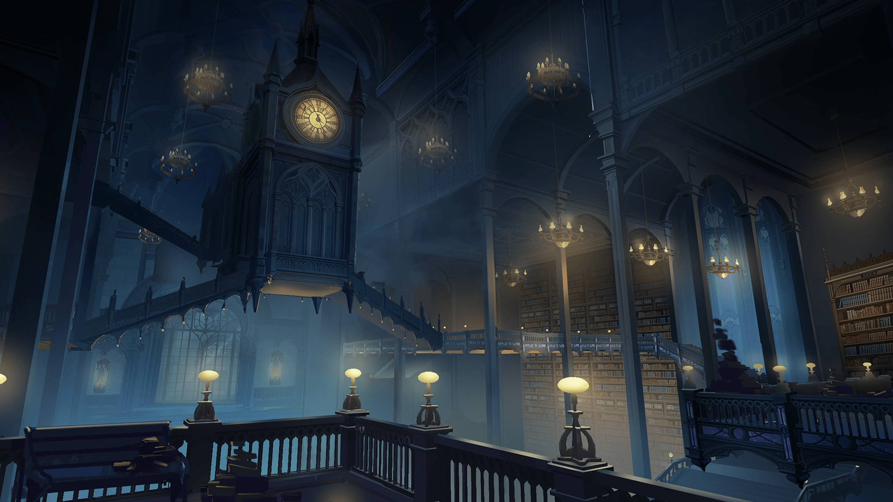
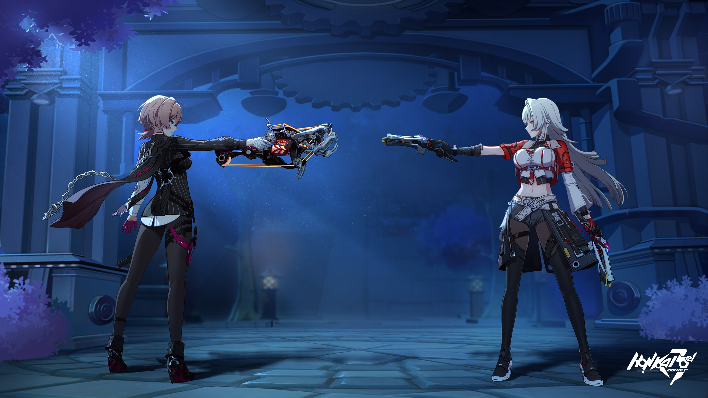

<div align="center">

# 🌌 Honkai Impact 3rd Part 2 — inspired Hyprland setup

**A Material You desktop for CachyOS / Arch Linux**
Hyprland 0.57 · Quickshell (end4-pC fork) · Matugen · Tokyo Night

[](https://hyprland.org)
[](https://quickshell.org)
[](https://cachyos.org)
[](#theming)



<sub>Hyprland 0.57 · end4-pC shell · Tokyo Night palette · 1920×1200 — bar, desktop widgets, floating dock</sub>

</div>

---

## ✨ What this is

My personal Hyprland desktop, rebuilt from scratch on **CachyOS**. It pairs the
[end-4 / illogical-impulse](https://github.com/end-4/dots-hyprland) ecosystem
with the [end4-pC](https://github.com/pctrade/end4-pC) Quickshell fork, then
layers on my own layout, keybinds, scripts and a **Honkai Impact 3rd Part 2**
wallpaper collection.

Everything is here: the Hyprland Lua config, the Quickshell shell config, helper
scripts, the wallpapers and the avatar. The only thing you need to bring is the
base installation (packages and the upstream dots).

> **Included:** 19 wallpapers, 1 live 4K video wallpaper, avatar, complete
> `~/.config/hypr`, shell `config.json`, 3 helper scripts, the local end4-pC
> patch and a 90+ page documentation book
> (`docs/Hyprland-Setup-Guide.docx`).

---

## 🖼️ Gallery

### 🎞️ Current wallpaper — live 4K video

<a href="wallpapers/goddess-dreamseeker-honkai-impact-3rd-moewalls-com.mp4">
  
</a>

<sub>Animated preview, 8 fps. GitHub does not play videos that live in a repository, so
**click the preview** to open the real file: 3840×2160, 60 fps, 10 s loop,
36 MB (`wallpapers/goddess-…-moewalls-com.mp4`).</sub>

| | |
|:---:|:---:|
|  |  |
| **Idle wallpaper** — the previous wallpaper | Lock screen wallpaper |
|  |  |
| Sidebar banner | Included wallpaper |
|  |  |
| Included wallpaper | Included wallpaper |

<p align="center">
  
  <br><sub>Profile avatar (also installed as <code>~/.face</code>)</sub>
</p>

All wallpapers — including the video — live in [`wallpapers/`](wallpapers). Game
artwork © HoYoverse / miHoYo — included for personal, non-commercial use only.

### How the live wallpaper stays alive

The wallpaper switcher starts one **mpvpaper** process per monitor (with an IPC
socket so the bar can pause/resume it) and writes
`__restore_video_wallpaper.sh`, which Hyprland runs at login. If that process
ever dies, the shell would silently show the still *Idle wallpaper* instead.
This repo therefore ships `local/bin/ensure-live-wallpaper` plus a systemd user
timer that checks every 30 s and restarts mpvpaper when needed:

```bash
systemctl --user status live-wallpaper-watchdog.timer   # is it armed?
~/bin/ensure-live-wallpaper                            # ...if it is not
~/.local/state/live-wallpaper.log                      # what did it do?
```

---

## 🧩 The stack

| Layer | What is used |
|---|---|
| Compositor | **Hyprland 0.57** — native Lua config (`hyprland.lua`) |
| Desktop shell | **Quickshell 0.3.2** running the **end4-pC** fork of illogical-impulse |
| Bar / widgets | Quickshell QML — bar, desktop widgets, floating dock, overview, sidebars |
| Colour engine | **Matugen 4.2** — Material You palettes from the wallpaper |
| Current palette | **Tokyo Night** named scheme (`#1A1B26` surface, `#C0CAF5` text) |
| Launcher / search | Quickshell overview (`SUPER` alone) |
| Notifications | Quickshell notification server (+ optional popups) |
| Lock / idle | Quickshell lock screen + **hypridle** |
| Clipboard | **cliphist** + `wl-paste` watchers |
| Input injection | **ydotool** (on-screen keyboard, paste helper) |
| Screenshots | **grim**, **slurp**, **wf-recorder**, **tesseract** (OCR) |
| Terminal | **Kitty**, **foot**, **fish** |
| Fonts | Google Sans Flex, JetBrains Mono NF, Space Grotesk, Readex Pro, Material Symbols Rounded |
| Cursor | Bibata Modern Classic |

### Why Quickshell and not eww/waybar?

The original end-4 dots moved from **eww/AGS** to **Quickshell**. Quickshell is
a Wayland-native Qt/QML shell: every panel is a QML file, colors come from a
single Material theme singleton, and the whole desktop (bar, dock, lock screen,
notifications, OSD, on-screen keyboard, wallpapers) is one process. There is no
`eww` or `waybar` in this setup and nothing to configure in YAML/SCSS — the UI
lives in `~/.config/quickshell/end4-pC` and its settings in
`~/.config/illogical-impulse/config.json`.

---

## ✅ Requirements

- **Arch Linux or an Arch derivative** (tested on CachyOS). Debian/Fedora are
  not supported by the upstream installer.
- A Wayland-capable GPU: **AMD, Intel or NVIDIA**. The machine this was built
  on is a hybrid Intel iGPU + NVIDIA RTX 4050 laptop, but nothing is
  NVIDIA-specific: `install.sh` detects your cards and writes the right
  environment (see [GPU support](#-gpu-support-amd--intel--nvidia)).
- An **AUR helper** (`paru` or `yay`) for the `illogical-impulse-*` packages.
- ~2 GB free disk space (the Quickshell build is the big part).

### Extra packages used by this repo

```bash
paru -S --needed hyprland hypridle hyprlock hyprsunset hyprpicker \
  quickshell-git matugen cliphist wl-clipboard ydotool grim slurp wf-recorder \
  tesseract tesseract-data-eng imagemagick jq ffmpeg cava easyeffects \
  fuzzel kitty foot fish dolphin brightnessctl playerctl \
  illogical-impulse-fonts-themes illogical-impulse-quickshell-git
```

> `illogical-impulse-quickshell-git` is the patched Quickshell build from the
> end-4 AUR set. The fork **requires** it (it uses Hyprland global shortcuts
> that stock `quickshell` does not expose the same way).

---

## GPU support (AMD / Intel / NVIDIA)

The configuration is vendor-neutral. There is no `LIBVA_DRIVER_NAME=nvidia`,
`GBM_BACKEND=nvidia-drm` or hard-coded `AQ_DRM_DEVICES` anywhere in the repo.
Those were what made an earlier version fail on AMD: on an AMD card they point
at a device that does not exist and force the NVIDIA GBM backend, so Hyprland
either refuses to start or renders a black screen.

Instead `~/bin/gpu-env` reads `/sys/class/drm`, works out which card drives
your panel and writes the matching block into `~/.config/hypr/custom/env.lua`.
`install.sh` runs it automatically:

```bash
~/bin/gpu-env            # what did it find?
~/bin/gpu-env --write    # (re)generate the block after a GPU/driver change
```

| Hardware detected | What `env.lua` gets |
|---|---|
| **AMD only** | nothing — Mesa picks `amdgpu` / `radeonsi`; `LIBVA_DRIVER_NAME=radeonsi` only when `libva-mesa-driver` is installed |
| **Intel only** | `LIBVA_DRIVER_NAME=iHD` (`i965` on very old iGPUs) |
| **NVIDIA only** | `NVD_BACKEND=direct`; `LIBVA_DRIVER_NAME=nvidia` only when `nvidia-vaapi-driver` is installed |
| **Hybrid (iGPU + dGPU)** | `AQ_DRM_DEVICES=/dev/dri/<card that drives the internal panel>` plus the lines above |

```bash
~/bin/gpu-env                     # this laptop: 2 GPUs detected
#   card0  0x10de NVIDIA  nvidia
#   card1  0x8086 Intel   i915  (primary) [internal panel]
#   -> AQ_DRM_DEVICES=/dev/dri/card1, LIBVA_DRIVER_NAME=iHD, NVD_BACKEND=direct
```

Drivers and packages:

| Vendor | Packages |
|---|---|
| **AMD** | `mesa libva-mesa-driver vulkan-radeon` (+ `lib32-mesa lib32-vulkan-radeon` for 32-bit) |
| **Intel** | `mesa intel-media-driver vulkan-intel` |
| **NVIDIA** | `nvidia-open` or `nvidia`, `nvidia-utils`; optional `nvidia-vaapi-driver` for VAAPI in browsers/mpv |

Aquamarine (Hyprland's backend) supports all three. On a hybrid laptop the
compositor is pointed at the panel's GPU and the dGPU stays free for games and
rendering.

> Remove NVIDIA exports (`LIBVA_DRIVER_NAME=nvidia`, `GBM_BACKEND=nvidia-drm`,
> `__GLX_VENDOR_LIBRARY_NAME=nvidia`) from `~/.bashrc`, `~/.profile` and
> `/etc/environment` before switching to an AMD card. `env.lua` can regenerate
> the variables for apps, but a stale `GBM_BACKEND` in the session environment
> is still read by the compositor at start-up.

---

---

## 🚀 Installation

### 1. Install the base (illogical-impulse)

The shell needs the upstream dots for fonts, Python venv, themes and helper
scripts:

```bash
git clone https://github.com/end-4/dots-hyprland
cd dots-hyprland
./setup install
```

Pick your GPU options when asked. When it finishes, you have a working `ii`
shell. Log out and back in (choose **Hyprland** in the login screen) to verify
it before continuing.

### 2. Clone this repo

```bash
git clone https://github.com/Pushkar7270/HonkaiImpact3rd-part-2-inspired-hyprland-setup.git
cd HonkaiImpact3rd-part-2-inspired-hyprland-setup
```

### 3. Run the installer

```bash
./install.sh
```

The script will:

1. back up anything it is about to replace (to `~/.config-backup-<timestamp>`),
2. copy `config/hypr` → `~/.config/hypr`,
3. **detect the GPUs** (AMD / Intel / NVIDIA) and write the matching
   environment into `~/.config/hypr/custom/env.lua` with `gpu-env`,
4. copy the shell `config.json` → `~/.config/illogical-impulse/config.json`,
5. install `local/bin/*` → `~/bin` and the fish PATH snippet,
6. install and enable the **live-wallpaper watchdog**
   (`live-wallpaper-watchdog.timer` — restarts `mpvpaper` within 30 s if the
   video wallpaper ever dies),
7. copy all wallpapers → `~/Pictures/Wallpapers` and create the
   `~/Wallpapers` symlink,
8. install the avatar as `~/.config/quickshell/avatar/avatar.png` and `~/.face`,
9. clone **end4-pC** to `~/.config/quickshell/end4-pC` and apply
   `docs/end4-pC-local.patch` (the local widget/cheatsheet/on-screen-keyboard
   fixes),
10. point `qsConfig` at `end4-pC` and restart the shell.

Then log out and back in once. That's it.

### Manual installation (if you prefer to do it by hand)

```bash
# 1. shell fork + local patch
git clone https://github.com/pctrade/end4-pC.git ~/.config/quickshell/end4-pC
git -C ~/.config/quickshell/end4-pC checkout 6b4485b
git -C ~/.config/quickshell/end4-pC apply ~/path/to/docs/end4-pC-local.patch

# 2. configs
cp -a config/hypr ~/.config/hypr
cp config/illogical-impulse/config.json ~/.config/illogical-impulse/config.json

# 3. GPU environment for *this* machine (AMD / Intel / NVIDIA)
cp local/bin/* ~/bin/ && chmod +x ~/bin/*
~/bin/gpu-env --write

# 4. wallpapers + avatar
mkdir -p ~/Pictures/Wallpapers
cp wallpapers/* ~/Pictures/Wallpapers/
ln -sfn ~/Pictures/Wallpapers ~/Wallpapers
cp avatar/avatar.png ~/.config/quickshell/avatar/avatar.png
cp avatar/face.jpg ~/.face

# 5. live-wallpaper watchdog (systemd user units)
mkdir -p ~/.config/systemd/user
cp config/systemd/user/* ~/.config/systemd/user/
systemctl --user daemon-reload
systemctl --user enable --now live-wallpaper-watchdog.timer

# 6. select the shell
echo 'hl.env("qsConfig", "end4-pC")' > ~/.config/hypr/custom/variables.lua

# 7. restart
hyprctl reload && killall qs; qs -c end4-pC & disown
```

The `config.json` and the Hyprland scripts contain absolute paths
(`/home/dreamseeker/...`). `install.sh` rewrites them to your `$HOME`
automatically; if you copy manually, run:

```bash
sed -i "s|/home/dreamseeker|$HOME|g" \
  ~/.config/illogical-impulse/config.json
~/bin/gpu-env --write      # env.lua is generated from your hardware
```

---

## ⌨️ Shortcuts (the important ones)

| Keys | Action |
|---|---|
| `SUPER` (tap) | Search / overview |
| `SUPER + Return` | Terminal |
| `SUPER + W` | Browser |
| `SUPER + E` | File manager (Dolphin) |
| `SUPER + I` | Settings app |
| `SUPER + Escape` | Open/close the shell settings panel |
| `SUPER + /` | Cheat sheet (all 100+ binds) |
| `SUPER + A` / `SUPER + N` | Left / right sidebar |
| `SUPER + Tab` | Workspace overview |
| `SUPER + V` | Clipboard history |
| `SUPER + Period` | Emoji picker |
| `SUPER + J` | Toggle the bar |
| `SUPER + K` | On-screen keyboard |
| `SUPER + M` | Media controls |
| `SUPER + L` | Lock |
| `CTRL + ALT + Delete` | Session menu |
| `CTRL + SUPER + T` | Change wallpaper |
| `CTRL + SUPER + P` | Switch panel family (ii ↔ waffle) |
| `SUPER + SHIFT + S` | Region screenshot → clipboard |
| `SUPER + SHIFT + X` | Region OCR → clipboard |
| `Print` | Full screenshot → clipboard |
| `SUPER + SHIFT + R` | Record region (again to stop) |
| `SUPER + ALT + ←/→/↑/↓` | Snap windows (Windows-style) |
| `Scroll_Lock` | Release stuck modifier keys |

The complete, auto-generated list is in
[`docs/end4-pC-Shortcuts.md`](docs/end4-pC-Shortcuts.md), and the live list is
one keystroke away: **`SUPER + /`**.

---

## 🎨 Theming

The whole UI is Material You. One palette drives the bar, widgets, dock, lock
screen, GTK apps, Qt apps, terminals and fuzzel.

```
wallpaper ──► matugen ──► ~/.local/state/quickshell/user/generated/colors.json
                      ├──► ~/.config/hypr/hyprland/colors.lua
                      ├──► ~/.config/hypr/hyprlock/colors.conf
                      ├──► ~/.config/gtk-3.0/gtk.css / gtk-4.0/gtk.css
                      ├──► ~/.config/fuzzel/fuzzel_theme.ini
                      └──► KDE colour scheme, terminal sequences
```

- **Quick change:** Settings (`SUPER + Escape`) → *Interface* → palette /
  wallpaper / fonts.
- **Named scheme:** Settings → *Interface* → *Color Schemes* → pick
  `Tokyo Night`, `Catppuccin`, `Nord`, `Gruvbox`, `Dracula`, `Everforest`,
  `One Dark`, `Rosé Pine`. They live in
  `~/.config/quickshell/end4-pC/scripts/colors/schemes/*.json`; your own go to
  `~/.config/illogical-impulse/schemes/`.
- **Wallpaper-derived:** set `appearance.palette.type` to `auto` (or
  `scheme-content`, `scheme-expressive`, …) and switch wallpaper.
- **Live video wallpaper:** the current wallpaper is
  `wallpapers/goddess-…-moewalls-com.mp4` — a 3840×2160, 60 fps loop played by
  the shell on its wallpaper layer (mpvpaper). Put a video in
  `~/Pictures/Wallpapers` and pick it in the wallpaper selector like any image;
  the still above it stays as the *Idle wallpaper* for the lock/idle screen and
  as the Matugen source when the named scheme is cleared.
- **Create a new theme:** the 90+ page guide in
  [`docs/Hyprland-Setup-Guide.docx`](docs/Hyprland-Setup-Guide.docx) has a
  step-by-step chapter (palette JSON format, matugen templates, Hyprland colours,
  lock screen, GTK/Qt/terminal, fonts and shapes).

The current theme is **Tokyo Night**, applied at
`~/.config/illogical-impulse/config.json → appearance.palette.namedScheme`.

---

## 📁 Repository layout

```
.
├── config/
│   ├── hypr/                    # ~/.config/hypr (Lua config, rules, keybinds, lock)
│   ├── illogical-impulse/
│   │   └── config.json          # shell settings (bar, widgets, dock, theme…)
│   ├── systemd/user/            # live-wallpaper-watchdog.service + .timer
│   └── fish/conf.d/             # PATH snippet for ~/bin + ~/.local/bin
├── local/bin/                   # gpu-env, ensure-live-wallpaper (watchdog),
│                                # refresh-wallpapers, set-avatar, unstick-keys
├── wallpapers/                  # 19 wallpapers + 1 live 4K video
├── avatar/                      # avatar.png + face.jpg
├── docs/
│   ├── desktop.png                 # screenshot used at the top of this README
│   ├── live-wallpaper.gif          # animated preview of the video wallpaper
│   ├── Hyprland-Setup-Guide.docx   # the 90+ page documentation book
│   ├── end4-pC-Shortcuts.md        # every keybind
│   └── end4-pC-local.patch         # local changes on top of the fork
├── install.sh
└── README.md
```

### What is custom vs upstream?

| Path | Origin |
|---|---|
| `config/hypr/hyprland/*` | end-4 dots (Lua config) |
| `config/hypr/custom/*` | **mine** — machine env, snapping, screenshots, Super fix |
| `config/illogical-impulse/config.json` | **mine** — layout, widgets, Tokyo Night |
| `docs/end4-pC-local.patch` | **mine** — waffle panel port, cheatsheet, ydotool fixes |
| end4-pC shell | [pctrade/end4-pC](https://github.com/pctrade/end4-pC) |
| dots / fonts / venv | [end-4/dots-hyprland](https://github.com/end-4/dots-hyprland) |

---

## 🛠️ Troubleshooting

| Symptom | Fix |
|---|---|
| `hyprctl configerrors` shows something | check the line number; most errors come from a value above a new Hyprland limit |
| Shell does not start | `qs -c end4-pC` in a terminal and read the output; logs in `/run/user/$UID/quickshell/by-id/*/log.log` |
| Wallpaper switch stalls | the `notify-send` upscale prompt — this repo already patches it |
| Live wallpaper frozen or looking static | stock `switchwall.sh` runs `mpvpaper -a max`, which pauses the video as soon as **any** window is maximized. This repo's patch uses `-a full` (only a real fullscreen window pauses it). Re-apply: `~/bin/ensure-live-wallpaper` |
| Live wallpaper vanished after a while | the watchdog restarts it within 30 s. Check `systemctl --user status live-wallpaper-watchdog.timer` and `~/.local/state/live-wallpaper.log` |
| Wallpaper is back to the still image after a reboot | `hyprland/execs.lua` runs `__restore_video_wallpaper.sh` at login; if it is the placeholder, pick the video once in the wallpaper selector |
| `pkill` killed my terminal while switching wallpapers | old script used `pkill -f mpvpaper`; the patched script uses `pkill -x mpvpaper` |
| Stale wallpaper thumbnails | `~/bin/refresh-wallpapers` |
| Everything types in CAPS | `Scroll_Lock` (releases stuck virtual modifiers) |
| Blurry/oversized UI on a hybrid GPU | `~/bin/gpu-env --write`, then log out and back in |
| **AMD: black screen, or Hyprland will not start** | a stale `GBM_BACKEND=nvidia-drm` / `LIBVA_DRIVER_NAME=nvidia` is still in the session environment. Remove it from `~/.bashrc`, `~/.profile` and `/etc/environment`, delete `~/.config/hypr/hyprland.conf` if it is an old copy, then run `~/bin/gpu-env --write` |
| **AMD: video wallpaper stutters** | install `libva-mesa-driver` (and `mesa`); `mpvpaper` uses `hwdec=auto` → VAAPI. Check with `vainfo` |
| **Wrong GPU is used on a hybrid laptop** | `~/bin/gpu-env --write` writes `AQ_DRM_DEVICES` for the card with the internal panel; `hyprctl systeminfo` shows what Hyprland picked. `AQ_DRM_DEVICES` is only read at start-up, so log out and back in |
| Switched from NVIDIA to AMD | the repo no longer ships `hyprland.conf` (it had NVIDIA envs and fixed `eDP-1`/`HDMI-A-1` monitors); remove any leftover copy in `~/.config/hypr/` |
| `SUPER+<key>` also opens search | fixed by the `input.keyboard.key` handler in `custom/keybinds.lua` |

More detail — logs, GPU setup, portals, locale, memory tuning — is in the docx.

---

## 🙏 Credits

- **[end-4](https://github.com/end-4/dots-hyprland)** — illogical-impulse, the
  original design, QML modules and scripts (GPL-3.0).
- **[pctrade](https://github.com/pctrade/end4-pC)** — the end4-pC Quickshell fork.
- **[Quickshell](https://quickshell.org)** — the shell framework.
- **[Hyprland](https://hyprland.org)** — the compositor.
- **[Matugen](https://github.com/InioX/matugen)** — Material You colour generation.
- **miHoYo / HoYoverse** — Honkai Impact 3rd artwork (wallpapers only, not mine).

## 📄 License

Configuration files, scripts and documentation: **GPL-3.0**, matching the
upstream projects. Wallpapers and avatar are personal/fan content and are not
covered by that license — please keep them for personal use.

---

<div align="center">
<sub>Built on CachyOS · Hyprland 0.57 · Quickshell 0.3.2 · Tokyo Night</sub>
</div>
